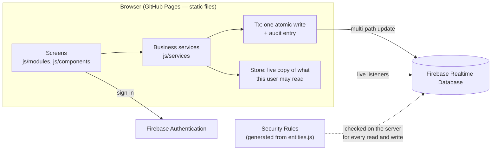
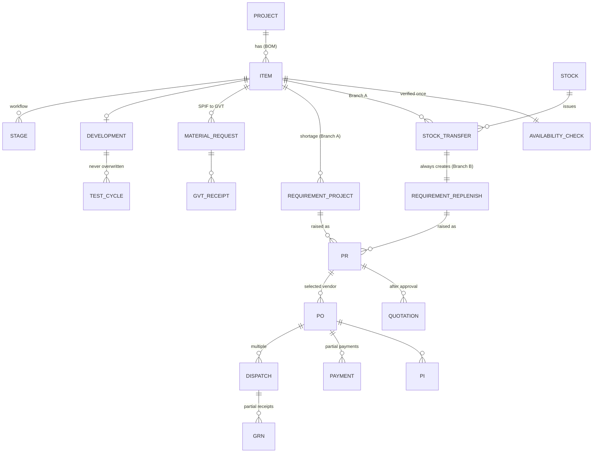
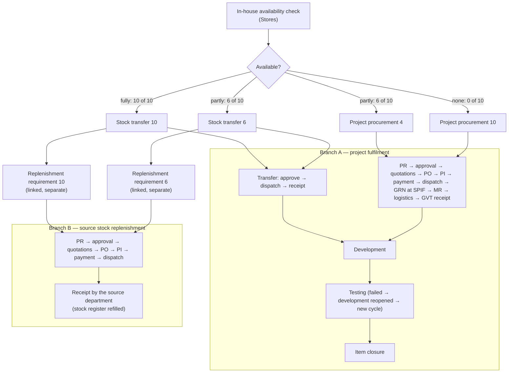

# ProjectFlow 360 — Architecture

This document answers the “first task” of the requirements (A–I). It explains the design in plain
language first, then the details.

## A. System architecture



**In plain words.** The website itself is just files. When someone signs in, Firebase
Authentication confirms who they are. Every time the page reads or saves anything, Firebase checks
the Security Rules on its own servers: *Is this person active? Do they have this permission in this
module? Do they have access to this project? Does this change follow the business rules?*
If not, Firebase refuses — whatever the page or a tampered browser asks for. The screens hide
buttons a user cannot use, but that is only convenience.

Because the project uses Firebase's free plan (no Cloud Functions), the rules are the trusted
backend. The README (section 6) lists exactly what that changes.

**Demo mode** replaces Firebase with the browser's local storage but runs the **same rules file**
through a built-in rules evaluator, so the demo behaves like production.

## B. Database schema

Records of a project are stored per project, so access can be checked per project:
`/{collection}/{projectId}/{recordId}`. Inside a record, fields are grouped by the permission
needed to change them:

```json
"purchaseRequests": {
  "DRN-A1": {
    "PR-DRN-A1-0003": {
      "core":     { "requirementId": "REQ-DRN-A1-0004", "itemId": "IT-DRN-A1-0002", "itemCode": "FC-H743",
                    "qty": 2, "procurementType": "Project Requirement", "purpose": "…",
                    "requestingDeptId": "planning", "requestDate": "2026-10-23", "requestedBy": "u_planning" },
      "status":   { "status": "Approved" },
      "approval": { "decision": "Approved", "approverId": "u_planning_head", "approverName": "…", "decisionAt": 1767000000000 },
      "selection":{ "selectedQuotationId": "QTN-DRN-A1-0001", "selectionJustification": "…" },
      "agg":      { "orderedQty": 2 },
      "meta":     { "createdAt": 1767000000000, "createdBy": "u_planning", "updatedAt": 1767000000000,
                    "updatedBy": "u_planning_head", "_v": 3, "_log": "-o3k…" }
    }
  }
}
```

| Path | Contents |
|---|---|
| `/system` | `initialized`, `bootstrapUid` (one-time set-up) |
| `/acl/{authUid}` | effective permissions of an active account: `userId`, `scope`, `d` (departments), `p` (module → actions), `prj` (projects), `sa` |
| `/users/{userId}` | profile: username, display name, role, departments, scope, projects, overrides, active, last login |
| `/loginIndex/{username}` | sign-in lookup (`v`, `userId`), failed-login counter, reset request |
| `/roles`, `/departments`, `/settings` | configuration (Super Admin) |
| `/projects/{projectId}` | project (global, keyed by its unique Project ID) |
| `/inventory/{stockId}` | stock register per department: on hand, reserved |
| `/projectItems`, `/inventoryChecks`, `/stockTransfers`, `/procurement`, `/purchaseRequests`, `/quotations`, `/purchaseOrders`, `/proformaInvoices`, `/payments`, `/paymentAdjustments`, `/dispatches`, `/materialReceipts`, `/materialRequests`, `/gvtReceipts`, `/logistics`, `/travelDesk`, `/gatePasses`, `/gatePassReturns`, `/development`, `/developmentUpdates`, `/testing`, `/closures`, `/stages` | project records: `/{coll}/{projectId}/{id}` |
| `/activityLogs/{projectId}/{logId}` | append-only audit trail of every record change (old and new values) |
| `/auditLogs/{logId}` | append-only system events: sign-in/out, users, roles, settings, backups |
| `/comments/{projectId}/{module}/{dept}/{id}` | comments, scoped by module and department |
| `/documents/{projectId}/{module}/{id}`, `/documentBlobs/…` | attachment metadata and small files |
| `/notifications/{userId}/{id}` | in-app notifications |
| `/counters/{projectId}/{collection}` | sequential numbering (only ever increases) |
| `/projectIndex/byManager`, `/byDept` | discovery hints for limited-scope users (grant no access) |

The full field list of every record type is in `js/config/entities.js`; the rules are generated
from it (`firebase/build-rules.mjs`).

**Integrity mechanisms.** Unique IDs (`PR-DRN-A1-0001`…); references between records instead of
copies; `createdAt/By`, `updatedAt/By` with server time; record version `_v` must rise by exactly
one (no lost updates, no duplicates); all linked changes in one atomic multi-path write (for
example: a GRN + the dispatch's received quantity + the PO's received/accepted quantities + the
source-department stock); totals such as `paidTotal` must move by exactly the amount of the
payment written in the same update.

## C. Roles and granular permission matrix

Nine actions per module: **V**iew, **C**reate, **E**dit, **D**elete, **Cm** comment,
update **S**tatus, **U**pload, **A**pprove, e**X**port (plus *view all departments* for comments).
Department Head and Department User are *department-restricted*: outside the modules their
departments own they can only view (financial modules not even that). Defaults below; the Super
Admin can change any role, create new roles and override single permissions per user.

| Module | Super Admin | Project Manager | Dept Head (Planning) | Dept User (Sourcing) | Dept User (Accounts) | Dept User (Stores) | Viewer |
|---|---|---|---|---|---|---|---|
| Projects | V C E D Cm S U A X | V C E Cm S U X | V Cm X | V Cm X | V Cm X | V Cm X | V |
| Project items (BOM) | V C E D Cm S U A X | V C E Cm S U X | V C E Cm S U A X | V Cm X | V Cm X | V Cm X | V |
| Inventory and availability | V C E D Cm S U A X | V Cm X | V Cm X | V Cm X | V Cm X | V C E Cm S U X | V |
| Stock transfers | V C E D Cm S U A X | V Cm A X | V Cm X | V Cm X | V Cm X | V C E Cm S U X | V |
| Procurement requirements | V C E D Cm S U A X | V Cm A X | V C E Cm S U A X | V Cm X | V Cm X | V Cm X | V |
| Purchase requests | V C E D Cm S U A X | V Cm A X | V C E Cm S U A X | V Cm X | V Cm X | V Cm X | V |
| Vendor quotations | V C E D Cm S U A X | V Cm X | V Cm X | V C E Cm S U X | V Cm X | V Cm X | — |
| Purchase orders | V C E D Cm S U A X | V Cm X | V Cm X | V C E Cm S U X | V Cm X | V Cm X | — |
| Proforma invoices | V C E D Cm S U A X | V Cm X | V Cm X | V C E Cm S U X | V Cm X | V Cm X | — |
| Payments | V C E D Cm S U A X | V Cm X | — | — | V C E Cm S U X | — | — |
| Vendor dispatch | V C E D Cm S U A X | V Cm X | V Cm X | V C E Cm S U X | V Cm X | V Cm X | V |
| SPIF receipts (GRN) | V C E D Cm S U A X | V Cm X | V Cm X | V Cm X | V Cm X | V C E Cm S U X | V |
| Material requests | V C E D Cm S U A X | V Cm A X | V Cm X | V Cm X | V Cm X | V C E Cm S U X | V |
| GVT receipts | V C E D Cm S U A X | V Cm X | V Cm X | V Cm X | V Cm X | V C E Cm S U X | V |
| Logistics | V C E D Cm S U A X | V Cm X | V Cm X | V Cm X | V Cm X | V Cm X | V |
| Travel desk | V C E D Cm S U A X | V Cm A X | V Cm X | V Cm X | V Cm X | V Cm X | V |
| Gate passes (RGP/NRGP) | V C E D Cm S U A X | V Cm A X | V C E Cm S U A X | V Cm X | V Cm X | V Cm X | V |
| Development | V C E D Cm S U A X | V Cm X | V Cm X | V Cm X | V Cm X | V Cm X | V |
| Testing | V C E D Cm S U A X | V Cm X | V Cm X | V Cm X | V Cm X | V Cm X | V |
| Project closure | V C E D Cm S U A X | V C E Cm S U A X | V Cm X | V Cm X | V Cm X | V Cm X | V |
| Project expenditure | V X | V X | — | — | V X | — | — |
| Reports | V X | V X | V X | V X | V X | V X | V |
| Project activity history | V X | V X | V X | V X | V X | V X | V |
| Comments | V C E D All | V C E D All | V C E D All | V C E D | V C E D | V C E D | V |

Project access is a separate dimension: *all projects*, *projects of the user's departments*,
*selected projects* — and a project manager always sees the projects they manage.

## D. Project → item → inventory → procurement



Every PR, PO, dispatch and GRN carries its procurement type, so project procurement and
replenishment are separately identifiable everywhere. The item's eleven quantities (required,
available, reserved, transferred, procured for project, procured for replenishment, dispatched,
received, accepted, rejected, outstanding) are **calculated** from these records
(`js/services/quantities.js`) — never stored twice, so nothing can be double-counted.

## E. Parallel workflow: project fulfilment and source-stock replenishment



Cancelling or changing a transfer never deletes its replenishment requirement: the requirement
goes to **Under Review** and an authorised person decides (keep, change quantity, cancel), with
the reasoning recorded.

Stage statuses: Not Started, In Progress, Waiting for Approval, On Hold, Blocked, Completed,
Cancelled. **A date never changes a status.** Recording work moves a stage to *In Progress*;
*Completed* is set only by an authorised decision (verifying, approving, selecting a vendor,
declaring development complete, approving a test) or by an authorised person on the stage itself.

## F. Navigation and dashboard

The menu has ten entries. An area such as Procurement is one menu entry; its modules are tabs at
the top of the area's page, and only the tabs the user may view are shown.

| Menu entry | Tabs or screens |
|---|---|
| Dashboard | Adapts to role: six headline figures (six more under “More figures”), “Waiting for you”, critical activities, four charts (four more under “More charts”) |
| Projects | Project list → project page (Overview, Items/BOM, Timeline/Gantt, Activities, Expenditure, Documents, Comments, History, Closure) → item page (quantities, two-branch workflow, linked records, comments, documents, history) |
| My work | Department and personal work list |
| Deadlines | Overdue, due today, due soon, upcoming, on track |
| Procurement | Requirements, Purchase requests (with quotation comparison), Quotations, Purchase orders, Proforma invoices, Payments, Vendor dispatch |
| Material | Stock, Transfers, Receipts (GRN), Material requests, GVT receipts |
| Movement | Logistics, Travel, Gate passes (RGP/NRGP) |
| Engineering | Development, Testing |
| Reports | 25 reports |
| Administration (Super Admin) | Users, Roles, Departments, Settings, Audit log, Backup |

Forms show the required and most-used fields first; optional fields fold under “More details”.
The menu shows only areas with at least one module the user may view. Notifications and global search sit in the top bar.
Dashboard: 6 headline KPI tiles (the other 6 of the 12 under “More figures”) → “Waiting for you”
(approvals and assigned dated tasks) → critical activities table (every row opens the exact item and
stage) → 4 charts, with the other 4 of the 8 under “More charts”; each chart switches to a table.

## G. Authentication, Security Rules and (absent) Cloud Functions

- **Authentication:** Firebase Email/Password; usernames are mapped to internal addresses
  `username@pf360.example.com`. Passwords are never stored in the database.
- **Bootstrap:** the project owner creates the first sign-in account in the console and writes its
  UID to `/system/bootstrapUid`; only that account can initialise the system, once; the password
  must be changed at first sign-in.
- **Rules:** see README section 6. They are generated from the data dictionary (≈160 KB, Firebase
  limit 256 KB) and cover authentication, active status, role permissions, department
  restrictions, project access, record ownership (comments, documents), approvals, financial
  restrictions, append-only audit and the cross-record business rules.
- **Cloud Functions:** not used (free plan). The privileged operations are re-designed so the
  rules can protect them (README section 6 table). The code is structured so they could be moved
  into Cloud Functions later without changing the data.

## H. Development phases and testing plan

All seven phases of the requirements are implemented. Testing (`docs/TESTING.md`):
46 automated workflow / permission / rules tests, an independent rules-simulator cross-check, and
a browser smoke test of every screen for seven roles on desktop and phone.

## I. Risks, assumptions and decisions for your approval

| # | Decision / risk | What was done |
|---|---|---|
| 1 | Free Spark plan (your choice): no Cloud Functions, no Firebase Storage | Rules act as the backend; small files in the database, larger ones as links; reminders run in the browser; restore through the console. |
| 2 | User creation and password reset without server code | New sign-ins are issued by the admin's browser; orphan sign-ins have no access. |
| 3 | Client-written audit entries | Rules force user ID and server time and refuse record changes without a log entry; logs are append-only. |
| 4 | “SPIF” and “GVT” are treated as two sites: SPIF = central receiving store, GVT = development / test site | Rename in the screens if needed. |
| 5 | Replenishment receipts go back into the source department's stock register | Shown as “Source department receipt” in Branch B. |
| 6 | Items fulfilled from stock skip the SPIF → GVT stages by default | “Add SPIF → GVT stages” on the item page adds them when that movement is needed. |
| 7 | Self-approval of PRs is off by default | Settings → “Allow people to approve their own purchase requests”. |
| 8 | Scale | Designed for dozens of users and hundreds of projects (README section 10). |
| 9 | Firebase mode not exercised against a live project during the build | Rules verified by two independent evaluators; first-run checklist in `docs/TESTING.md`; “Check security rules” button in Settings. |
